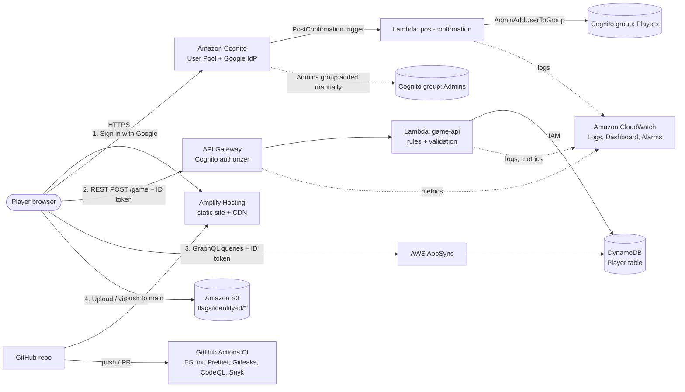

# Architecture - Black Tide (AWS Amplify, serverless)

## Request flow (example: finishing a battle)

1. The player signs in with Google; Cognito returns an ID token. The Post Confirmation Lambda adds new users to `Players`.
2. The browser calls `POST /game {action:'startMatch'}`: API Gateway checks the token with the Cognito authorizer, then invokes the `game-api` Lambda, which records the start time in DynamoDB.
3. The battle runs in the browser against bots. At the end the browser calls `POST /game {action:'matchResult'}`; the Lambda validates it (match started, duration, caps) and writes gold/XP to DynamoDB.
4. The leaderboard uses a GraphQL query through AppSync (read-only for signed-in users). Flag images are uploaded to and read from S3 with the user's Cognito identity.
5. Every Lambda invocation writes structured logs to CloudWatch Logs; the `BlackTide-Monitoring` dashboard and two alarms watch errors, duration and API 4XX/5XX.

## Requirement map

| #   | Requirement                       | Where                                                                                   |
| --- | --------------------------------- | --------------------------------------------------------------------------------------- |
| 1   | Google sign-in via Cognito        | `amplify/auth/resource.ts`, `signInWithRedirect` in `src/net.js`                        |
| 2   | Groups + Post Confirmation Lambda | `groups: ['Admins','Players']`, `amplify/functions/post-confirmation/`                  |
| 3   | REST + GraphQL, protected         | REST: `amplify/backend.ts` + `functions/game-api/`; GraphQL: `amplify/data/resource.ts` |
| 4   | S3 pictures                       | `amplify/storage/resource.ts`, `uploadFlag()` in `src/net.js`                           |
| 5   | GitHub to Amplify CI/CD           | `amplify.yml` + connect repo in the Amplify console                                     |
| 6   | CI checks                         | `.github/workflows/ci.yml`                                                              |
| 7   | CloudWatch                        | dashboard and alarms in `amplify/backend.ts`                                            |
| 8   | Live deployment                   | Amplify Hosting URL                                                                     |
